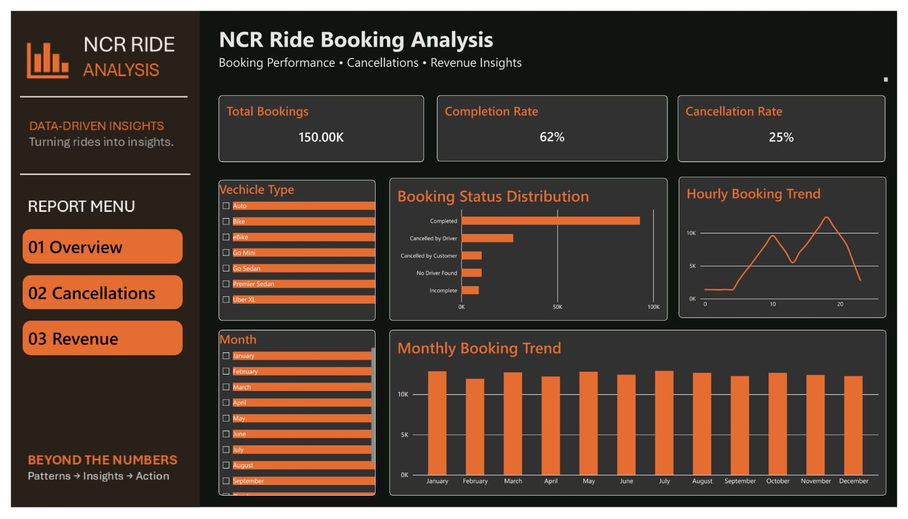
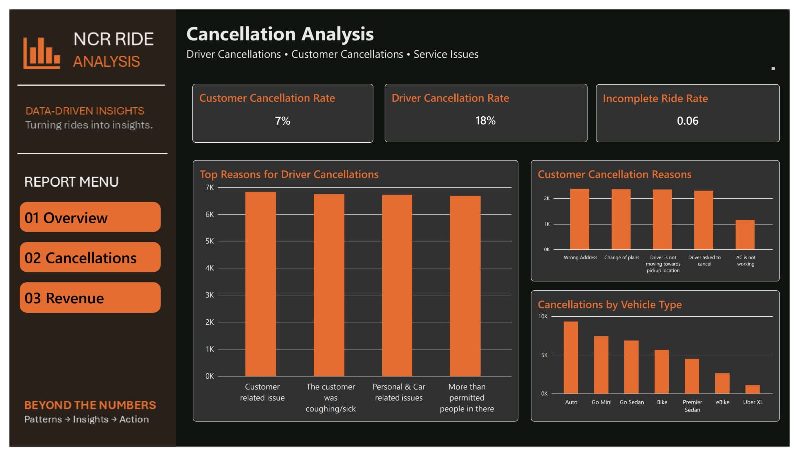
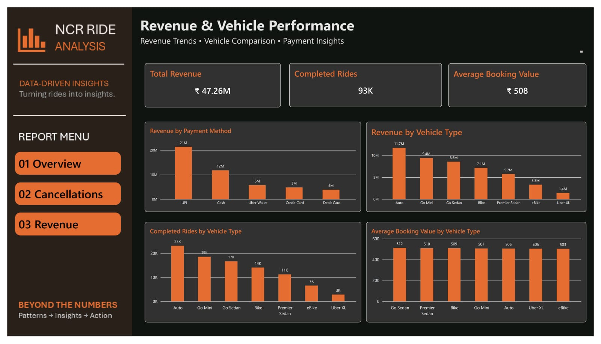

# Uber NCR Ride Analysis

End-to-end analysis of 150,000 Uber ride bookings from the Delhi NCR region, covering **Python (pandas) data cleaning & EDA**, **MySQL business analysis**, and a **3-page Power BI dashboard**.

> Goal: understand booking performance, why rides get cancelled, and where revenue comes from.

---

## Tools Used

| Stage | Tool |
|---|---|
| Data cleaning & EDA | Python, pandas, matplotlib (Jupyter Notebook) |
| Business analysis | MySQL, MySQL Workbench |
| Dashboard | Power BI |

---

## Dataset

- **File:** `ncr_ride_bookings.csv` (not included in this repo)
- **Size:** 150,000 rows x 21 columns (23 after cleaning)
- **Covers:** booking date/time, status, vehicle type, pickup/drop location, waiting-time measures (Avg VTAT / Avg CTAT), cancellation reasons, booking value, ride distance, ratings, payment method
- **Booking statuses:** Completed, Cancelled by Driver, Cancelled by Customer, No Driver Found, Incomplete

---

## Project Structure

```
.
├── Uber_Ride_Analysis.ipynb      # Stage 1: cleaning, validation, EDA
├── 01_Database_Setup.sql
├── 02_Data_Quality_Checks.sql
├── 03_Booking_Performance.sql
├── 04_Customer_Analysis.sql
├── 05_Business_Insights.sql
├── images/
│   ├── Booking_Analysis.jpeg
│   ├── Cancellation_Analysis.jpeg
│   └── Revenue_Analysis.jpeg
└── README.md
```

---

## Stage 1: Python – Cleaning & EDA

**Cleaning and validation**
- Checked shape, data types, missing values and duplicate rows (0 duplicate rows)
- Converted `Date` and `Time` to proper types (0 invalid values)
- Removed stray quotation marks from `Booking ID` and `Customer ID`
- Found **1,233 repeated Booking IDs** (1,215 appear twice, 9 appear three times), so created a unique `ride_id` for every row
- Confirmed no negative booking values / distances and no ratings outside 0–5
- Verified that missing values are **structural, not errors**. For example, "No Driver Found" rides have no value, distance, rating or payment info, and every cancelled / incomplete ride has its reason filled
- Created an `Hour` column and exported `uber_ride_cleaned.csv`

**Analysis done:** monthly and hourly trends, status distribution, cancellations by vehicle type and by hour, cancellation reasons, booking value, payment methods, ratings, VTAT/CTAT, top pickup/drop locations, customer activity.

---

## Stage 2: SQL – Business Analysis (MySQL)

Database: `uber_ride_analysis`, table: `uber_ride` (loaded from the cleaned CSV).

| File | What it does |
|---|---|
| `01_Database_Setup.sql` | Select DB, check table structure, count records |
| `02_Data_Quality_Checks.sql` | Duplicate ride IDs, missing booking/customer IDs, negative values/distances |
| `03_Booking_Performance.sql` | Top routes by total and completed bookings |
| `04_Customer_Analysis.sql` | Repeat customers, cancellations per customer, highest total and average booking value, outcome comparison |
| `05_Business_Insights.sql` | Cancellation rates by pickup location, route and payment method; incomplete rides by vehicle and reason; driver cancellation reasons; longest waiting pickup locations; highest-value routes |

SQL concepts used: `GROUP BY`, `HAVING`, `CASE WHEN`, aggregate functions, conditional counts, rate calculations, `ORDER BY` / `LIMIT`.

---

## Stage 3: Power BI Dashboard

### 1. Overview


### 2. Cancellation Analysis


### 3. Revenue & Vehicle Performance


---

## Key Findings

- **150,000** bookings in total, **62%** completed
- **Driver cancellations (18%)** are far higher than customer cancellations (7%)
- No-driver-found (7%) and incomplete rides (6%) make up the rest
- Booking demand is evenly spread across months (about 12K per month)
- Two daily peaks: around **10 AM** and a bigger one around **6 PM**; lowest around 4 AM
- Driver cancellation rate stays around 17–19% in every hour, so it is not a rush-hour problem
- Top driver cancellation reasons are almost equally split (about 6.7K each): customer related issue, customer coughing/sick, personal & car issues, more than permitted people
- Top customer cancellation reasons: wrong address, change of plans, driver not moving towards pickup, driver asked to cancel
- Completed rides generated **₹47.26M** revenue with an average booking value of **₹508**
- **Auto** has the highest total revenue (₹11.7M) and most completed rides (23K)
- **UPI** is the most used payment method (about 42K completed rides), followed by Cash
- Average booking value, ratings and waiting times are almost the same across all vehicle types

> These findings describe this dataset only. Differences between vehicle types are very small, so no strong conclusions should be drawn from them.

---


## Author

**Dharshini JG**
B.Sc Computer Science, Thiagarajar College, Madurai
[GitHub](https://github.com/dharshini-75) · [LinkedIn](https://www.linkedin.com/in/dharshini-gunasekaran-5474a5319/)
